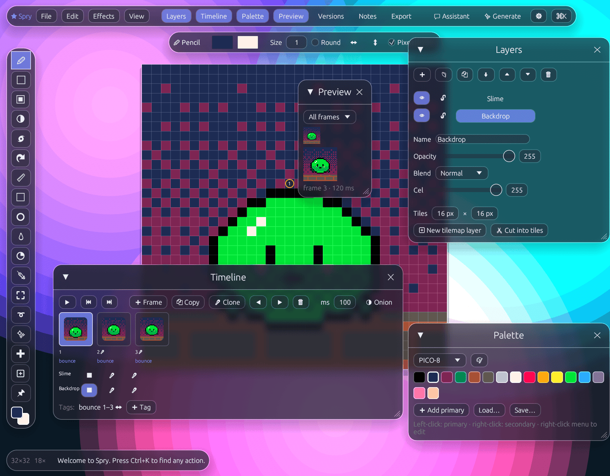

# Spry

A cross-platform pixel art, sprite and animation editor, written in Rust. It
has a frosted-glass interface, MS Paint-style dithers, Aseprite-style
animation, automatic sprite sheets, version history and notes. It's also
built for working alongside AI: any LLM can drive it over MCP, and diffusion
models can sketch ideas that land on your grid and in your palette.



The slime above is [`docs/screenshots/slime.spry`](docs/screenshots/slime.spry).
Spry exported it as an [animated GIF](docs/screenshots/slime-bounce.gif) of
its `bounce` tag and as a [sprite sheet](docs/screenshots/slime-sheet.png).
The window shot comes from `spry capture`.

- **Rules of the house:** [`CLAUDE.md`](CLAUDE.md)
- **Product bible (features and acceptance scenarios):** [`docs/BIBLE.md`](docs/BIBLE.md)

## Run it

Download a build for Linux (x86_64), Windows (x86_64) or macOS (Apple
Silicon or Intel) from [Releases](https://github.com/andrewfader/spry/releases).
Each one is built and tested by GitHub Actions when a `v*` tag is pushed,
and comes with a `SHA256SUMS` file. Or build it yourself:

```sh
cargo run --release                       # the editor
cargo run --release -- hero.spry          # open a file (.spry, .aseprite, .png or .gif)
cargo run --release -- mcp hero.spry      # serve MCP over stdio for an agent
cargo run --release -- export hero.spry --sheet hero.png --layout packed --trim --merge
cargo run --release -- info hero.spry
cargo run --release -- capture shot.png hero.spry   # save a picture of the window
```

On Linux the window needs the usual X11/Wayland and OpenGL libraries.
macOS and Windows need nothing extra.

## What's in it

**Drawing.** Pencil with pixel-perfect strokes (for 1-pixel brushes, where corners matter), eraser, line, rectangle,
ellipse (outlined or filled, Shift for squares and circles), bucket fill
(contiguous or global), spray, eyedropper (or Alt-click), colour replace,
brush sizes (square or round), and left↔right / top↕bottom mirror symmetry.
Right-click paints with the secondary colour.

**MS Paint dithers.** Eleven classic pattern fills (checker, 25%, 75%, dots,
lines, diagonals, cross-hatch, bricks) plus Bayer 2×2, 4×4 and 8×8 levels.
Patterns work with the dither brush, shapes and bucket, in one or two colours.
They're anchored to the canvas, so neighbouring strokes tile seamlessly. A
dither-gradient tool draws ordered gradients between two colours.

**Aseprite-style animation.** Layers with opacity, visibility, lock, reorder,
duplicate and merge down, Aseprite's nineteen blend modes, per-cel opacity,
and groups (nested, with their own opacity and blend). Frames with per-frame durations, tags with
forward / reverse / ping-pong loops, onion skin (up to 8 frames each way,
fading with distance), a live preview, and timeline thumbnails. Opens
`.aseprite` / `.ase` files: layers, cels and offsets, linked cels, tags,
palette, slices, and RGBA, grayscale and indexed colour, with groups, blend
modes, cel opacity, tilesets and tilemap layers intact.

**Tilesets.** Tilemap layers paint with a tileset: draw a tile once, place
it anywhere with the Tile tool (T), and fixing it fixes every copy. Every
drawing tool works on a tilemap. Cut an existing layer into tiles
(identical ones stored once), mirror placements, share a tileset between
layers, and export the tiles plus Tiled-style JSON maps.

**Clones.** "Clone frame" makes linked cels: paint one and every linked cel
changes. Unlink when you want them to part ways. There's also a clone stamp
tool (Alt-click to pick the source).

**Selection.** Rectangle and lasso select, Rotsprite rotation by any angle, magic wand, select all / invert, cut / copy /
paste, move with mouse or arrow keys, flip, rotate 90°, and painting clipped
to the selection.

**Palettes.** PICO-8, DawnBringer 16/32, Endesga 32, Sweetie 16, Game Boy and
NES built in. Load and save `.hex` / `.gpl`, extract a palette from the art, a
ramp-aware shade tool that lightens or darkens along the palette, and
snap-to-palette with optional dithering.

**Effects.** 1px or 8-way outline, drop shadow. These are real edits, so they
undo.

**Versions and notes.** Every save records a version (unless nothing changed),
and you can commit named versions any time. Browse them with thumbnails and
pixel-diff counts, restore one (undoable), or branch it into a new document.
Notes come in three kinds: on the document, on a frame, or pinned to a pixel
on the canvas. They're saved in the file and exported in the sheet JSON.

**Exports.** PNG at 1–16× (nearest neighbour only), animated GIF with
transparency and frame delays rounded to GIF's 10 ms steps without drifting (whole animation or one tag), animated PNG (APNG) with full alpha and exact
delays, lossless WebP (one frame or animated, exact delays), PNG sequences,
and sprite sheets (strip, grid, or shelf-packed, with padding, border,
trimming and duplicate merging) with Aseprite-format JSON (`frames`,
`frameTags`, `slices`, plus Spry's `notes`). It can also import a sheet back
into frames, detecting the grid from transparent gutters.

**MCP.** `spry mcp [file]` serves 41 tools and the document and its frames as resources over stdio: drawing with
colours, patterns and brushes, a text pixel grid, a rendered PNG the model can
look at, layers, frames, clones, tags, palettes, notes, versions, exports,
picture import onto the grid and palette, diffusion generation, undo, and `run_command` for every other editor verb. In the app, enable
**Settings → MCP server** and an agent can paint into the open window while
you watch:

```sh
claude mcp add --transport http spry http://127.0.0.1:7477/mcp
claude mcp add spry -- spry mcp path/to/sprite.spry
```

**AI assistant.** A chat panel driven by Claude (`claude-opus-5-5` by
default, with server-side refusal fallback) or a local Ollama model. It uses
the same tools as MCP and sees the canvas, and one Ctrl+Z undoes its whole
turn. It keeps working on the document it started on even if you switch
tabs, and a document it creates opens in a new tab.

**Diffusion.** Generate through Automatic1111/Forge (`--api`) or ComfyUI,
with presets for small pixel-art checkpoints, Pixel Art XL, LCM/Turbo models,
item icons and tiles, plus any LoRA by name and weight (a prompt tag for
Automatic1111, a LoraLoader node for ComfyUI). Images are generated in the
canvas's shape, then downscaled by dominant colour, cleared of their
backdrop, and quantised to your palette before they arrive as a new layer
in the document they were asked for. img2img restyles the current frame on
both backends. ComfyUI can also use your own exported API workflow. With
**Fit the subject** on, the backdrop is cut away at full size and only the
subject is shrunk, proportions kept, standing on the canvas's bottom edge.
Agents generate too, with the `generate_image` MCP tool: over stdio it waits
for the picture, and in the app it runs in the background like the button.
A failed ComfyUI run is reported straight away with the node that failed.
[`docs/workflows/z-image-turbo.json`](docs/workflows/z-image-turbo.json) is
a ready workflow for Z-Image Turbo (9 steps, cfg 1, size 1024).

**Glass UI.** A luminous backdrop, frosted panels (a real GPU blur of what's
behind them) you can float anywhere, remembered where you leave them,
dark and light glass, a command palette (Ctrl+K) that reaches every action,
Aseprite shortcuts (B, E, G, I, L, U, M, V, X, Alt+[ / Alt+], Enter to play,
Tab for onion skin), zoom about the cursor, space/middle-drag to pan, a pixel
grid, and a tiled 3×3 preview for seamless textures.

## Tests

The acceptance scenarios in `tests/features/` read like the Bible. They drive
the real headless editor, the real file formats, the real `spry` binary over
MCP, and local HTTP servers that speak the Claude, Ollama, Automatic1111 and
ComfyUI APIs.

```sh
cargo test
```
